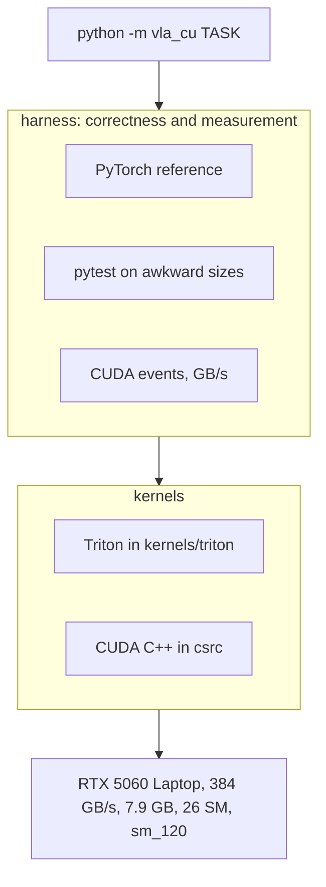
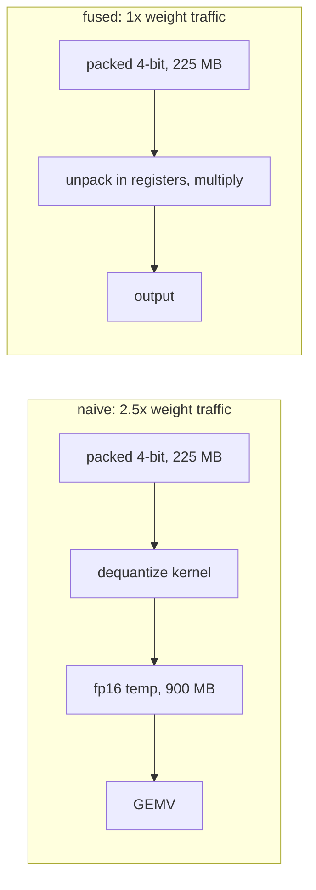

# Architecture

Tables and diagrams only. Rules live in `CLAUDE.md`. Measured results live in
`agents/`.

## 1. Layers

| Layer | Path | Job | State |
|---|---|---|---|
| Entry point | `vla_cu/__main__.py` | `python -m vla_cu <task>` | tasks `env`, `probe`, `cuda-check`, `bench`, `launch`, `gemv`, `graph`, `tune`, `matrix`, `layer`, `cuda`, `stream`, `grouped`, `m50`, `rotate`, `fastpath`, `crossover`, `attn`, `attncross`, `pairedtail`, `int8tiles`, `int8pair`, `floor`, `body`, `coop`, `block`, `fuzz`, `bundle`, `real`, `scale`, `plateau`, `ncu`, `sass`, `style` |
| Harness | `vla_cu/`, `tests/`, `bench/` | reference answers, timing, memory cap | planned |
| Kernels | `kernels/triton/`, `csrc/` | the arithmetic | started |
| Memory | `agents/` | state, experiments, decisions | live |

## 2. Traffic: naive against fused

At batch 1 a matrix-vector product reads each weight once. Dequantizing to a
temporary buffer pays for the weights twice.

## 3. Roofline position

| Quantity | Value | Note |
|---|---|---|
| Work per weight | 2 FLOP | one multiply and add |
| Bytes per weight | 0.5 B at 4-bit, 2 B at bf16 | plus one scale per group |
| Arithmetic intensity | about 1 to 4 FLOP/byte | lower at 4-bit |
| Ridge point | about 50 FLOP/byte | estimate from peak FLOPs and 384 GB/s |
| Verdict | memory-bound, well below the ridge | speed equals weight streaming rate |

## 4. Memory budget

450M parameters, arithmetic only. The floor is bytes divided by 384 GB/s.

| Item | 4-bit | bf16 |
|---|---|---|
| Weights | about 225 MB | about 900 MB |
| Group scales, group 64, fp16 | about 14 MB | none |
| Read per forward pass | about 239 MB | about 900 MB |
| Latency floor | about 0.62 ms | about 2.3 ms |
| Remaining room under the 7 GB cap | activations at batch 1 are megabytes; the rest absorbs workspace and fragmentation | |

## 5. Precision ladder

Only two rungs need a kernel. The dense rungs exist so every result has
something honest to compare against.

| Format | Storage per parameter | Unpacking | Role | Read per pass, 450M parameters |
|---|---|---|---|---|
| fp32 | 4 B | none | exact reference in tests | 1.8 GB |
| bf16 | 2 B | none | dense baseline, what plain torch runs | 900 MB |
| int8, one scale per channel | 1 B | one value per byte, no bit surgery | first quantization win, near lossless | 450 MB |
| int4, one scale per group of 64 | 0.5 B plus a shared scale | two values per byte, shift and mask | project target | 225 MB plus about 14 MB |

At 384 GB/s those become about 4.7, 2.3, 1.2 and 0.62 ms. Arithmetic, not
measurements. fp32 and bf16 are not kernel work: torch already ships those
kernels, so they are used as references and as performance baselines.

## 6. Kernel roadmap

| # | Kernel | Concept to learn | Path | State |
|---|---|---|---|---|
| 1 | vector add | program id, offsets, mask | `kernels/triton/vector_add.py` | done, 86.2% of peak at 16M elements |
| 2 | int8 GEMV | one program per row, reduction, per-channel scale | `kernels/triton/int8_gemv.py` | done, 92.4% of peak at 8192 x 16384 |
| 3 | reduction | shared memory, warp shuffles | undecided | backlog |
| 4 | naive matmul | tiling by block | undecided | backlog |
| 5 | packed 4-bit weights | group scales, unpacking | `vla_cu/quant.py` | done, layout and reference dequantize |
| 6 | fused dequant GEMV | group-major reduction, scale per group not per byte | `kernels/triton/int4_gemv.py` | done, 0.230 ms, 85.5% of peak at 8192 x 16384 |
| 7 | CUDA C++ port | warp per row, uint32 weight loads, shuffle reduction | `csrc/int4_gemv.cu` | done, three variants: baseline, unroll, streaming |
| 8 | custom op | `torch.library.custom_op` plus a fake kernel | `vla_cu/ops.py` | done, one MLP block end to end |
| 9 | streaming loads | `__ldcs` on one-shot weights, keep x resident | `csrc/int4_gemv.cu` | done, fastest kernel, 0.198 to 0.220 ms at 8192 x 16384 |
| 10 | grouped launch | one launch for a layer's projections, segment table | `kernels/triton/int4_grouped_gemv.py` | done, 2.73x at 960 x 960, bit identical |
| 11 | graphed block | capture two launches, replay | `bench/layer.py` | done, 0.018 to 0.019 ms against 0.053 raw |
| 12 | attainable ceiling | read-only streaming probe, repeated and interleaved | `bench/bandwidth_probe.py` | done, 346 to 360 GB/s, spread up to 2x |
| 13 | M = 50 probe | 50 GEMV calls against one GEMM on the expert shape | `bench/m50.py` | done, the expert needs a GEMM, 33 to 148x |
| 14 | rotation | block Hadamard before packing, accuracy not speed | `bench/rotation.py` | done, outlier cosine 0.98788 to 0.99586 |
| 15 | fast path | native streaming kernels for int8 and int4, captured in a graph | `bench/fastpath.py`, `csrc/int8_gemv.cu` | done, 0.015 ms per block against 0.069 fp32, bit exact |
| 16 | int4 GEMM | dequantize into `tl.dot`, sweep M from 1 to 64 | `kernels/triton/int4_gemm.py`, `bench/crossover.py` | done, GEMM wins from M = 2, 25 to 51x at M = 50 |
| 17 | attention block | q, k, v on one activation vector through the grouped launch | `bench/attention.py` | done, 0.011 ms graphed against 0.052 fp32, cosine 0.98804 |
| 18 | rotation in the fast path | block Hadamard at pack time plus a per-block activation rotate | `vla_cu/rotate.py`, `bench/fastpath.py` | done, neutral on Gaussian weights, 0.005 ms per block, opt-in |
| 19 | grouped int8 | segment table for the int8 path, the same idea as the int4 grouped launch | `kernels/triton/int8_grouped_gemv.py` | done, attention reads 0.99994 at int8, 0.019 ms graphed |
| 20 | block composition | attention then MLP, precision chosen per matrix | `vla_cu/blocks.py` | done, four blocks read 0.99951 cosine at 0.140 ms |
| 21 | fuzz gate | seeded random shapes against float64 | `bench/fuzz.py` | done, 160 cases, zero failures |
| 22 | weight bundle | versioned archive of packed matrices, CPU load | `vla_cu/bundle.py` | done, bit exact, 5.81x smaller than fp32 |
| 23 | chunk projections | one GEMM per projection instead of one GEMV per token, int8 twin of the int4 GEMM, MLP included | `kernels/triton/int8_gemm.py`, `vla_cu/blocks.py` | done, 158 launches per 50 token layer against 500, exact |
| 25 | fused residual norm | one program per row writes the residual sum and its RMSNorm from the same registers | `kernels/triton/rmsnorm.py` | done, 11 launches per layer and 4.468 ms at 50 tokens and 16 layers |
| 26 | stream K | K split across programs, partials summed by the last arrival through an acquire release counter, one launch | `kernels/triton/int4_gemm.py` | done, bit exact and racecheck clean, parity with the single launch so default off |
| 24 | fused grouped attention | program per (token, kv head), rope inside, cos and sine tables shared with the einsum path | `kernels/triton/gqa_attention.py` | done, 20 to 24x the einsums at 1 to 50 tokens, max diff 8.34e-07 |
| 27 | balanced stream K | one contiguous slice of the flattened (tile, K step) work list per program, boundary partials summed by the last arrival | `kernels/triton/int4_gemm.py` | done, 1.04x on 1920 outputs and 0.89x on 720, bit exact, default off |
| 28 | paired tail bench | the per-token loops and the chunk kernels alternate inside one process, so one clock state serves both | `bench/paired_tail.py` | done, 61.5x the row kernels and 48.7x the MLP at 50 tokens, 1.97x for the MLP at 2 |
| 29 | depth sweep | every depth at every token count, graph against eager on the same buffers | `bench/scale.py` | done, graph 3.18x to 5.66x eager at 2 to 8 tokens and 1.41x to 1.86x at 50, exact at all 80 pairs |
| 30 | int8 tile sweep | every candidate tile timed at the expert widths and token counts | `bench/int8_tiles.py` | done, every candidate inside 0.041 to 0.052 ms, so the tile sits inside the launch floor's noise |
| 31 | launch floor | a launch loop against a one node graph, an empty kernel against the int4 GEMM | `bench/launch_floor.py` | done, 6 us host gap and a 9 us empty kernel, so the 47 us GEMM body is the cost |
| 32 | persistent layer | a grid barrier and five fused stages | not kept | negative, a two program sense barrier never exits, so Triton here has no usable device barrier |
| 33 | cooperative tail | add, norm, int8 up, SiLU, int4 down, add in one launch with two grid barriers | `csrc/coop_layer.cu`, `bench/coop.py` | done, 2.91x at 1 token and 2.28x at 2, 1.15x at 8, 0.22x at 50, within 1.4e-3 |
| 34 | body split | K step size, K length, format and program count at 50 tokens | `bench/body.py` | done, time is linear in bytes at 20 to 23 GB/s and flat in the step count, so the dequant path is the cost |
| 35 | int8 paired tiles | menu pick against three challengers, alternating inside one process | `bench/int8_pair.py` | done, a 16 row tile won every repeat by 1.07x to 1.53x, so the menu changed |
| 36 | cooperative hardening | device-aware shared memory setup, occupancy bound, alignment checks, token boundaries 1 to 64 | `csrc/coop_layer.cu` | done, memcheck 0 errors, 10 tests pass |
| 37 | CI gates | style, task registry and the suite on a CPU runner, device tests skipped with a reason | `.github/workflows/ci.yml`, `tests/conftest.py` | done, 35 passed and 169 skipped with no device |
| 38 | fused scaling sweep | 1 to 64 tokens, fused against the five launches, paired | `bench/coop.py` | done, 2.91x at 1 token, 1.15x at 8, 0.70x at 16, 0.25x at 64; two widths in EXP-090 |
| 39 | tensor core body | 16 x 16 WMMA tiles over a shared activation tile, at two K staging depths | `csrc/coop_layer_kernel.cuh`, not kept | negative, 0.247 and 0.427 ms at 1 token against 0.042 for the GEMV body, reverted (EXP-084) |
| 40 | runtime widths | hidden and intermediate from the tensors, shared memory and tile counts sized from them | `csrc/coop_layer.cu`, `vla_cu/cuda_coop.py` | done, tested at 720/1920, 256/640 and 384/768 |
| 41 | public layer | `Int4Linear` holds the packed weight, dispatches to the GEMV at one token and the GEMM above it | `vla_cu/linear.py` | done, exported from `vla_cu`, tested at both ranks |
| 42 | one-command gate | memcheck over the int4 variants and the cooperative kernel, with an attach failure reported separately from a memory error | `bench/sanitize.py` | done, cooperative kernel clean, extension unattachable (EXP-087) |
| 43 | checkpoint builder | a layer prefix resolves q, k, v, o or gate, up, down, and gate_proj selects the SwiGLU block | `vla_cu/build.py`, `vla_cu/blocks.py` | done, five tests, gated and plain at one token and a chunk (EXP-088) |
| 44 | graph wrapper | one captured `Int4Linear` call, input copied into the static buffer, output reused | `vla_cu/linear.py` | done, replay matches eager bit for bit, wrong shape refused (EXP-089) |
| 45 | two-width tail sweep | 1 to 64 tokens at 720/1920 and 960/2560, first losing token count printed | `bench/coop.py` | done, both cross at 10 tokens, 0.44x against 0.67x at 16 (EXP-090) |
| 46 | gated cooperative tail | gate and up dots share one pass over the staged norm, two grid barriers as before | `csrc/coop_layer_kernel.cuh`, `bench/coop_gated.py` | done, 3.49x and 2.36x at 1 token, crossover 12 and 8 tokens (EXP-091) |
| 47 | graphed layer sweep | eager against `graphed()` at five shapes from 0.09 to 18.87 MB of packed weights | `bench/graph_layer.py` | done, 2.20x to 0.94x, so capture pays below about 1.5 MB (EXP-092) |

## 7. Measurement protocol

| Step | Handle | Gate |
|---|---|---|
| Correctness | `pytest tests/` | matches PyTorch on 1, 1023, 1025 |
| Memory safety, CUDA only | `compute-sanitizer` | zero errors |
| Timing | CUDA events, warmup plus 100 iterations | never wall clock |
| Report | GB/s and fraction of 384 GB/s | never milliseconds alone |

## 8. Tool stack

| Piece | Version | Why it is here |
|---|---|---|
| Python venv | 3.13 | isolation, since the torch wheel is GPU specific |
| PyTorch | 2.8.0+cu129 | reference answer, tensor plumbing, extension loader |
| Triton | 3.9.0 via `triton-windows` | fast kernel iteration with block and mask reasoning |
| CUDA C++ | toolkit 12.9.2, MSVC 14.44 | full control over shared memory and vectorized loads |
| Nsight and sanitizer | Nsight 2025.x, sanitizer 2025.2.1 | why a kernel is slow, and whether it is unsafe |

## 9. CUDA kernels

The two C++ ports are the fastest path and the only sources that need `nvcc`. Their
mapping lives here because source files carry no comments (DEC-010).

| Kernel | Mapping | Memory access | Expected bottleneck |
|---|---|---|---|
| `int4_gemv.cu` | one warp per output row; a lane reads 4 packed bytes, 8 weights, per step; 8 lanes share one 64-weight group and its scale | 128 contiguous bytes per warp instruction; two `float4` activation loads per lane; shuffle reduction, no shared memory | memory, N * K / 2 bytes |
| `int8_gemv.cu` | one warp per output row; a lane reads 16 int8 weights as one 16-byte vector; a guarded scalar tail covers K not divisible by 512 | fully coalesced 16-byte loads with `__ldcs`; four `float4` activation loads; shuffle reduction, no barrier | memory, N * K bytes |

The int4 file holds three variants so one run can attribute cost to one change. Variant
0 keeps one guarded loop, variant 1 splits it into a full-trip loop plus a tail so the
compiler can unroll four steps, and variant 2 adds `__ldcs` to the weight load. Every
launch uses `at::cuda::getCurrentCUDAStream()`, because a launch on the legacy default
stream is invisible to CUDA graph capture (DEC-031). The host wrapper requires group 64,
K divisible by 64, contiguous tensors and 16-byte aligned activations for int4; the int8
wrapper requires K divisible by 16 and 16-byte aligned weights and activations.
