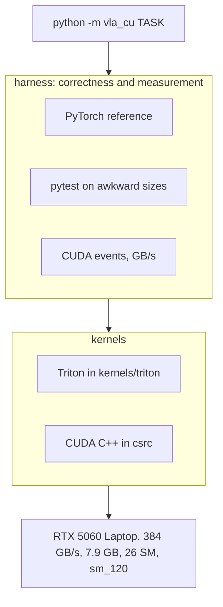
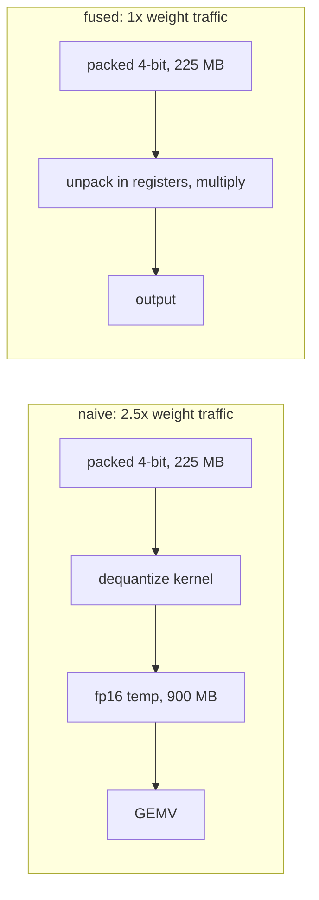

# Architecture

Tables and diagrams only. Rules live in `CLAUDE.md`. Measured results live in
`agents/`.

## 1. Layers

| Layer | Path | Job | State |
|---|---|---|---|
| Entry point | `vla_cu/__main__.py` | `python -m vla_cu <task>` | tasks `env`, `probe`, `cuda-check`, `bench` |
| Harness | `vla_cu/`, `tests/`, `bench/` | reference answers, timing, memory cap | planned |
| Kernels | `kernels/triton/`, `csrc/` | the arithmetic | started |
| Memory | `agents/` | state, experiments, decisions | live |

## 2. Traffic: naive against fused

At batch 1 a matrix-vector product reads each weight once. Dequantizing to a
temporary buffer pays for the weights twice.

## 3. Roofline position

| Quantity | Value | Note |
|---|---|---|
| Work per weight | 2 FLOP | one multiply and add |
| Bytes per weight | 0.5 B at 4-bit, 2 B at bf16 | plus one scale per group |
| Arithmetic intensity | about 1 to 4 FLOP/byte | lower at 4-bit |
| Ridge point | about 50 FLOP/byte | estimate from peak FLOPs and 384 GB/s |
| Verdict | memory-bound, well below the ridge | speed equals weight streaming rate |

## 4. Memory budget

450M parameters, arithmetic only. The floor is bytes divided by 384 GB/s.

| Item | 4-bit | bf16 |
|---|---|---|
| Weights | about 225 MB | about 900 MB |
| Group scales, group 64, fp16 | about 14 MB | none |
| Read per forward pass | about 239 MB | about 900 MB |
| Latency floor | about 0.62 ms | about 2.3 ms |
| Remaining room under the 7 GB cap | activations at batch 1 are megabytes; the rest absorbs workspace and fragmentation | |

## 5. Precision ladder

Only two rungs need a kernel. The dense rungs exist so every result has
something honest to compare against.

| Format | Storage per parameter | Unpacking | Role | Read per pass, 450M parameters |
|---|---|---|---|---|
| fp32 | 4 B | none | exact reference in tests | 1.8 GB |
| bf16 | 2 B | none | dense baseline, what plain torch runs | 900 MB |
| int8, one scale per channel | 1 B | one value per byte, no bit surgery | first quantization win, near lossless | 450 MB |
| int4, one scale per group of 64 | 0.5 B plus a shared scale | two values per byte, shift and mask | project target | 225 MB plus about 14 MB |

At 384 GB/s those become about 4.7, 2.3, 1.2 and 0.62 ms. Arithmetic, not
measurements. fp32 and bf16 are not kernel work: torch already ships those
kernels, so they are used as references and as performance baselines.

## 6. Kernel roadmap

| # | Kernel | Concept to learn | Path | State |
|---|---|---|---|---|
| 1 | vector add | program id, offsets, mask | `kernels/triton/vector_add.py` | done, 86.2% of peak at 16M elements |
| 2 | reduction | shared memory, warp shuffles | undecided | backlog |
| 3 | naive matmul | tiling by block | undecided | backlog |
| 4 | packed 4-bit weights | group scales, unpacking | undecided | backlog |
| 5 | fused dequant GEMV | read packed bytes once, unpack in registers | undecided | backlog |
| 6 | CUDA C++ port | explicit shared memory, vectorized loads | `csrc/` | backlog, toolkit ready |

## 7. Measurement protocol

| Step | Handle | Gate |
|---|---|---|
| Correctness | `pytest tests/` | matches PyTorch on 1, 1023, 1025 |
| Memory safety, CUDA only | `compute-sanitizer` | zero errors |
| Timing | CUDA events, warmup plus 100 iterations | never wall clock |
| Report | GB/s and fraction of 384 GB/s | never milliseconds alone |

## 8. Tool stack

| Piece | Version | Why it is here |
|---|---|---|
| Python venv | 3.13 | isolation, since the torch wheel is GPU specific |
| PyTorch | 2.8.0+cu129 | reference answer, tensor plumbing, extension loader |
| Triton | 3.9.0 via `triton-windows` | fast kernel iteration with block and mask reasoning |
| CUDA C++ | toolkit 12.9.2, MSVC 14.44 | full control over shared memory and vectorized loads |
| Nsight and sanitizer | Nsight 2025.x, sanitizer 2025.2.1 | why a kernel is slow, and whether it is unsafe |
